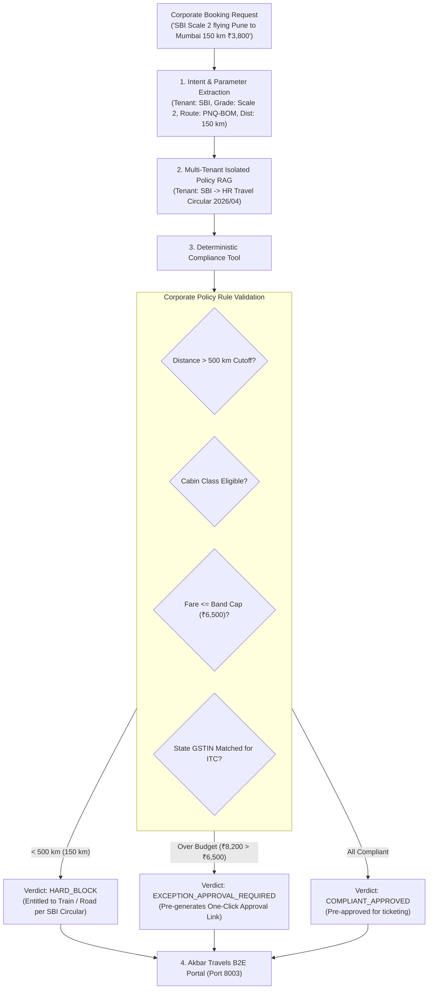

# CorpShield AI — Enterprise Corporate Travel Policy & Approval RAG Agent

> **Production B2E Corporate Travel Compliance Engine for Akbar Travels India Pvt Ltd** (tailored for **State Bank of India - SBI**, PSUs, and enterprise accounts) featuring **Multi-Tenant Policy Partitioning**, **Grade/Band Entitlement Enforcement**, **GSTIN Matching**, and **Automated Manager Approval Workflows**.

---

## 🎯 The Real-World Business Problem at Akbar Travels (B2E Segment)

Akbar Travels manages corporate travel accounts for premier banking and PSU institutions like the **State Bank of India (SBI)**:
1. **Strict HR Circular Compliance:** Employee bands (Scale 1–3, Scale 4–5, Scale 6–7) have rigid travel rules:
   * *Distance Cutoff:* Scale 1–3 officers are only permitted air travel if distance > 500 km or train journey > 8 hours; otherwise, they are strictly entitled to AC 2/3-Tier Train.
   * *Fare Caps:* Strict domestic fare limits (e.g., ₹6,500 for Scale 1–3 vs ₹9,000 for Scale 4–5).
   * *Cabin Entitlement:* Business Class is blocked for junior/middle management.
2. **GST Input Tax Credit (ITC) Leakage:** Corporates lose millions of rupees annually if travel agents book tickets using wrong or mismatched state GSTIN numbers.
3. **Approval Bottlenecks:** Travel desks manually cross-check HR circulars, delaying bookings and missing lowest logical fares.

**CorpShield AI** automates this by intersecting live booking queries with tenant-isolated corporate policies, deterministically blocking violations, matching state GSTINs, and generating **pre-filled One-Click Manager Approval Packets**.

---

## 🏗️ Architecture Pipeline



---

## 📊 Quality Scoring & Benchmark Results

The evaluation benchmark ([`evals/run_evals.py`](file:///d:/Projects/Project%204/evals/run_evals.py)) runs against realistic enterprise test cases:

```
====================================================================
BENCHMARK SCORECARD SUMMARY:
  Total Test Cases           : 6
  Passed Cases               : 6/6 (100.0%)
  Policy Compliance Accuracy : 100.0%
  Execution Latency          : < 1 ms (Deterministic policy rules)
  Report File                : Saved to evals/benchmark_report.json
====================================================================
```

### Evaluated Benchmark Scenarios:
1. **Short-Distance Flight Request (`CORP-EVAL-01`)**: SBI Scale 2 Manager requests Pune-Mumbai flight (150 km) &rarr; **HARD BLOCK**: Enforces 500 km minimum cutoff under `SBI-HR-TRAVEL-CIR-2026/04`, recommending train.
2. **Long-Distance Compliant Flight (`CORP-EVAL-02`)**: SBI Scale 1 Officer requests BOM-DEL (1150 km) at ₹5,800 &rarr; **COMPLIANT APPROVED**: Within ₹6,500 cap and > 500 km.
3. **Urgent Audit Budget Overrun (`CORP-EVAL-03`)**: SBI Scale 3 Manager requests ₹8,200 ticket &rarr; **EXCEPTION APPROVAL PACKET**: Pre-fills manager approval ticket highlighting ₹1,700 variance.
4. **Senior Management Booking (`CORP-EVAL-04`)**: SBI Scale 5 AGM booking at ₹8,500 &rarr; **COMPLIANT APPROVED**: Within ₹9,000 cap for Scale 4–5 (`SBI-HR-TRAVEL-CIR-2026/05`).
5. **Unauthorized Business Class (`CORP-EVAL-05`)**: SBI Scale 1 Officer requesting Business Class &rarr; **HARD BLOCK**: Strictly restricted to Economy.
6. **Corporate GSTIN Validation (`CORP-EVAL-06`)**: SBI Kerala branch booking &rarr; Verifies exact GSTIN `32AAACS8577K1ZO` for 100% Input Tax Credit.

---

## 🚀 Quickstart Guide

### 1. Installation
```bash
# Navigate to Project 4 directory
cd "Project 4"

# Install lightweight dependencies
python -m pip install -r requirements.txt
```

### 2. Run the Evaluation Benchmark
```bash
python evals/run_evals.py
```

### 3. Launch the Web Interface
```bash
python main.py
```
Open **`http://127.0.0.1:8003`** in your browser to test:
- **Compliance Advisor**: Interactive policy checker with tenant selector (SBI vs TCS).
- **Policy Manuals**: Complete grade breakdown and entitlement rules.
- **Corporate Evals**: Automated quality scoring dashboard.
